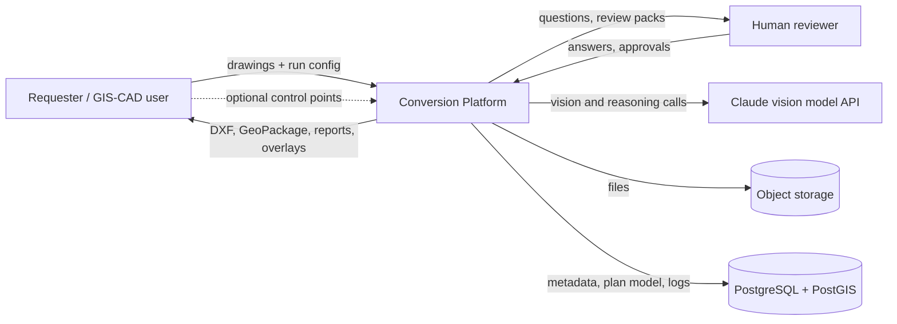
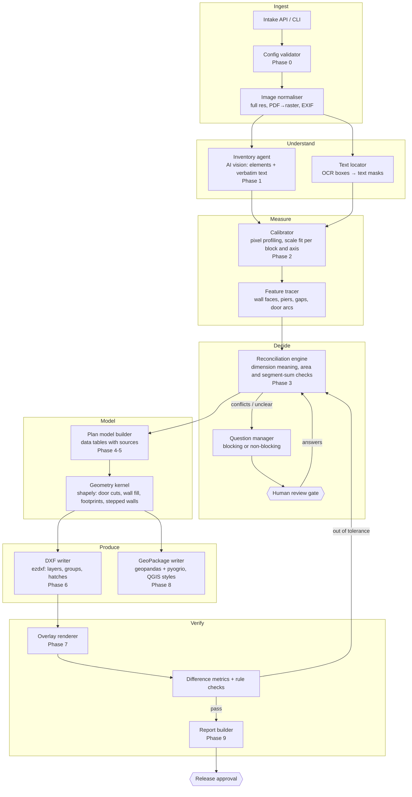
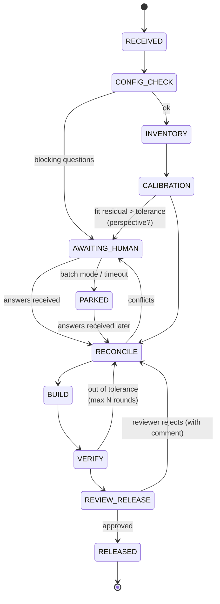
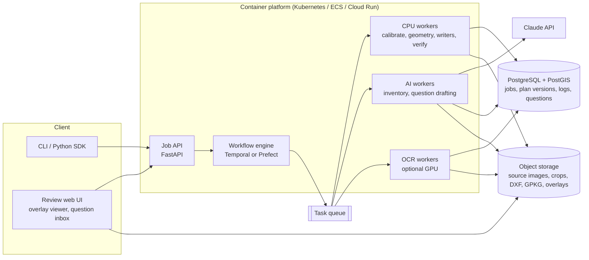

# Floor-Plan Image → CAD / GIS Conversion Platform
## High-Level Design (HLD) and Low-Level Design (LLD)

| | |
|---|---|
| Status | Draft v1. Based on the reference job in this folder. |
| Derived from | `PROMPT_floor_plan_to_cad_gis.md` (process), `build_floor_plan_dxf.py`, `build_geopackage.py`, `check_overlay.py` (reference implementation) |
| Scope | Turning raster floor-plan drawings (scans, screenshots, photos) into a DXF (CAD) and a GeoPackage (GIS), accurately and with an audit trail, for one drawing or many in bulk, with people reviewing anything unclear |

**What exists today and what is proposed.** The parts below marked **[built]**
exist as working code in this folder and produced the accepted output of the
reference job. The parts marked **[proposed]** are the design for scaling that
process up to a service. They are not built yet.

---

# PART 1 — HIGH-LEVEL DESIGN

## 1. Goals and constraints

### 1.1 What it must do

| ID | Requirement |
|---|---|
| F1 | Accept raster drawings (JPG/PNG/TIFF/PDF pages) with a run configuration. |
| F2 | Produce a DXF in metres, with layers, room groups and every label linked to its room. |
| F3 | Produce a GeoPackage with polygon, line and point layers, attributes and QGIS styles. |
| F4 | Keep the source layout: floors and sheets side by side, separate blocks with their gaps, offsets kept. |
| F5 | Reproduce every annotation word for word, at its position, height and rotation. |
| F6 | Ask questions about unclear or conflicting data, and hold the affected items until a person answers. |
| F7 | Check the output against the source image (overlay plus measured differences) before release. |
| F8 | Work in batches: many drawings, with a separate state for each and nothing failing silently. |

### 1.2 How well it must do it

| ID | Requirement | Target |
|---|---|---|
| N1 | **No invented data.** Every coordinate records where it came from (a label on the drawing or a pixel measurement). | 100% of features |
| N2 | Position accuracy after scale fitting | ≤ 0.05 m per zone |
| N3 | Area agreement with labels, or the difference explained | ≤ 0.5%, or a logged reason |
| N4 | Same inputs and answers give the same outputs | Byte-stable plan model. DXF and GeoPackage stable apart from timestamps. |
| N5 | Audit trail | Measurement log, uncertainty register, question log and model versions kept for each drawing |
| N6 | Throughput | Scales out to many workers. A person's review time is the only part that can't be sped up. |
| N7 | Security | Drawings may be confidential: private storage, no public links, every access logged |

### 1.3 Key design decisions

1. **The AI suggests; measurement decides.** The vision model lists elements,
   reads text and proposes structure. Coordinates come only from deterministic
   pixel measurement and the dimensions written on the drawing, and every value
   records which.
2. **One canonical plan model.** The DXF and the GeoPackage are both
   generated from the same versioned plan model, so they can't drift apart.
   In the reference job this role is played by the data tables in
   `build_floor_plan_dxf.py`.
3. **People review at defined gates.** These are set points in a state
   machine, not optional extras. Anything unanswered stays marked as
   unverified and can't be released.
4. **Checking is a separate stage.** The output is drawn over the source
   image and measured; it is not trusted just because it was built.
5. **Every lesson becomes a rule.** Each issue found in the reference job
   (Appendix A of the prompt) is an automated check with an ID (§11.4).

## 2. System context



## 3. Logical architecture (pipeline)



**Stages and where they come from in the reference job**

| Stage | Responsibility | Reference job [built] |
|---|---|---|
| Config validator | Check the run config; flag contradictions, such as stacking floors with no shared reference point | Prompt Phase 0 |
| Inventory agent | List every element and read all text word for word | Done by hand in-session; prompt Phase 1 |
| Text locator | Find text boxes so measurements can ignore text | **[proposed]**. The lack of it caused text to contaminate profiles in this job. |
| Calibrator | Find dark-pixel runs and fit a scale per block and axis | `runs()` profiles; fitted `gf()` and `ff()` mappings |
| Feature tracer | Trace stepped faces, piers, gaps and door hinges | ASCII profiles of the hatched wall and the gap under 13-OFF |
| Reconciliation engine | Work out whether a dimension measures the inside, outside or centre-line; check areas and dimension strings | The 13-OFF fix (9.31 m outside → 8.51 m inside = 49.53 m²); the 8.51 m dimension-string check |
| Question manager and review gate | Raise questions and hold affected items | Human feedback rounds in this job |
| Plan model builder | Data tables that record each value's source | `ROOMS`, `CIRCULATION`, `DOORS`, `GLASS`, `PARTITIONS`, `WALL_BLOCKS_13`, `STAIRS`, `*_TEXT` |
| Geometry kernel | Door cuts, wall fill, separate block outlines, stepped walls | `door_band`, `floor_geometry`, `ext_wall_13`, `_wall_blocks_13` |
| DXF writer | Layers, groups, hatches, text | `build()` |
| GeoPackage writer | Layers, attributes, styles | `build_geopackage.py` |
| Overlay and metrics | Draw the output over the source; measure differences | `check_overlay.py` (visual). Metrics **[proposed]**. |

## 4. Processing workflow (state machine per drawing)



Each change of state writes an event to the job log: who or what made it, why,
and which plan-model version it applied to. Repeated rounds are capped (for
example at 3 automatic fix-and-check rounds). After that the job goes back to
a person, so it can't keep changing the geometry on its own.

## 5. Deployment view [proposed]



- **Scaling:** each drawing is an independent workflow. Workers don't keep
  state between tasks, and all state lives in the database and object storage.
- **Human tasks:** the workflow engine pauses until a signal arrives. In batch
  mode the job is parked, so other drawings keep moving.
- **Reference job:** everything ran as local Python scripts in one session,
  with the person in the conversation acting as the reviewer.

## 6. Cross-cutting concerns

| Concern | Approach |
|---|---|
| Sources and audit | Every plan-model value carries `{source, evidence, residual, status}` (§9.1). The model is versioned and never overwritten. |
| No invented data | Building **refuses** any element whose status is `UNVERIFIED` unless the run allows placeholder output on the `A-UNVERIFIED` layer. Release is blocked while any such element exists. |
| Security | Private buckets, links that expire, encryption at rest, and per-tenant separation. Drawings are not sent anywhere except the configured AI API. Personal data in drawings (names, for example) is read word for word but never enriched. |
| Monitoring | Logs keyed by job ID. Metrics: share of zones within tolerance, questions per drawing, fix rounds, review time, AI tokens. Traces across stages. |
| Cost | AI only for listing elements and drafting questions; measurement and geometry use deterministic code. Crops are cached. |
| Reproducibility | Library versions pinned (§12). A seed is stored for anything random (there is none today). The plan model is the single input to both writers. |
| Georeferencing | Off by default (no CRS). With control points: fit an affine or similarity transform, report residuals, and write the CRS to the GeoPackage. |

---

# PART 2 — LOW-LEVEL DESIGN

## 7. Package layout [proposed; maps to the built scripts]

```
plan2cad/
  config/        schema.py            # RunConfig (pydantic) + validator       ← prompt RUN CONFIG
  ingest/        normalise.py         # load, PDF→raster, full-res, K factor
  understand/    inventory_agent.py   # AI vision → ElementRegister (no coordinates)
                 text_locator.py      # OCR boxes → text masks
  measure/       profiles.py          # runs(), ascii_map()                      ← built (inline)
                 calibrate.py         # fit_axis_scale(), fit_affine(), homography()  ← gf()/ff() fits
                 trace.py             # trace_face(), detect_gaps(), door_hinge()
  decide/        reconcile.py         # dim_semantics(), area_check(), segment_sum()
                 queries.py           # Query model, blocking logic
  model/         plan_ir.py           # PlanIR dataclasses + JSON (de)serialiser ← data tables
                 rules.py             # rule catalogue R01..R16 (§11.4)
  geometry/      kernel.py            # door_band, footprint, poche, stepped walls ← built
  export/        dxf_writer.py        # ezdxf layers, groups, hatches           ← build()
                 gpkg_writer.py       # geopandas/pyogrio + QGIS styles         ← build_geopackage.py
  verify/        overlay.py           # draw output over source                  ← check_overlay.py
                 metrics.py           # edge distance per zone, label-anchor check
  report/        report.py            # areas, measurement log, uncertainty register, questions
  pipeline/      workflow.py          # state machine (Temporal/Prefect)
  cli.py                              # plan2cad run|resume|verify|export
tests/  golden/reference_job/         # this folder's source + accepted outputs
```

## 8. Interfaces

### 8.1 CLI [proposed]

```
plan2cad run     --config run.yaml --out out/        # Phases 0–9; stops at the review gate
plan2cad answer  --job J --answers answers.yaml      # supply answers to questions, then continue
plan2cad verify  --job J                             # re-run the overlay and metrics only
plan2cad export  --job J --formats dxf,gpkg          # rebuild outputs from the plan model
```

### 8.2 Job API [proposed]

| Method | Path | Body / result |
|---|---|---|
| POST | `/jobs` | multipart: images + `run.yaml` → `{job_id}` |
| GET | `/jobs/{id}` | state, current plan-model version, open questions, metrics |
| GET | `/jobs/{id}/queries` | list of questions (§9.3) |
| POST | `/jobs/{id}/answers` | `{query_id: {option, note}}` → continues the workflow |
| POST | `/jobs/{id}/review` | `{decision: approve or reject, comments[]}` |
| GET | `/jobs/{id}/artifacts` | signed links: DXF, GPKG, overlays, report |

### 8.3 Internal Python interfaces (functions and their signatures)

```python
# measure/profiles.py                                   [built: runs()]
def runs(v: np.ndarray, offset: float, thr: int = 110) -> list[tuple[float, float]]
def ascii_map(img, x0, x1, y0, y1, step=2) -> str

# measure/calibrate.py                                  [built: gf()/ff() fitted by hand]
def fit_axis_scale(px: list[float], m: list[float]) -> tuple[float, float, float]  # scale, offset, rms
def fit_block_mapping(pairs: list[tuple[px_xy, m_xy]]) -> BlockMapping             # per block, per axis
def homography(src_px4, dst_m4) -> np.ndarray                                      # only if approved

# decide/reconcile.py
def dim_semantics(label_w, label_h, area_label, wall_t, measured_w, measured_h) -> Resolution
    # tries inside / outside / centre-line; returns the reading that matches both area and pixels, or a Query
def segment_sum(labels: list[float], span: float, tol: float) -> Check
def area_check(poly, area_label, cutouts=()) -> Check   # also reports net vs gross

# geometry/kernel.py                                    [built]
def door_band(floor, hinge, end, depth=0.25) -> Polygon
def floor_geometry(floor) -> dict(footprint, poche, band, solids)  # each block built and clipped separately
def stepped_wall(rect, blocks: list[Polygon]) -> tuple[room_poly, band_poly]

# export
def write_dxf(plan: PlanIR, path) -> AuditResult        # must report 0 errors
def write_gpkg(plan: PlanIR, path, layout="as_source", stack=None) -> dict[str, int]

# verify
def render_overlay(plan, source_img, mappings) -> Image
def zone_metrics(plan, source_img, mappings, zones) -> list[ZoneMetric]
```

## 9. Data model

### 9.1 Plan model (one JSON document per drawing, versioned)

```json
{
  "plan_id": "job-123/v7",
  "source": {"file": "source_sketch.jpg", "px": [4080, 1884], "view_factor_K": 2.04},
  "units": "m",
  "sheets": [
    {"id": "GF", "sheet_offset": [0, 0],
     "mapping": {"x0": 365, "sx": 48.0, "y0": 905, "sy": 48.0, "rms_m": 0.03}},
    {"id": "FF", "sheet_offset": [14.0, 0],
     "mapping": {"x0": 1125.8, "sx": 46.18, "y0": 879.9, "sy": 45.36, "rms_m": 0.04}}
  ],
  "elements": [
    {"id": "13-OFF", "type": "room", "sheet": "FF",
     "polygon": [[0.3, 9.08], [0.3, 9.28], [0.2, 9.28], "... stepped face ..."],
     "dims": {"label_outer": [9.31, 6.03], "resolved": "outer", "wall_t": 0.4},
     "area": {"label": 49.53, "calc_gross": 49.53, "calc_net": 49.12},
     "provenance": {"source": "label+pixel",
                    "evidence": ["profile y=270 x1135..1528", "segment-sum top=8.51"],
                    "residual_m": 0.02},
     "status": "VERIFIED", "rules": ["R02", "R09"]},
    {"id": "D-04WCS", "type": "door", "sheet": "GF", "room": "04-WCS",
     "hinge": [8.34, 6.14], "end": [9.09, 6.14], "swing": -1,
     "checks": {"hinge_jamb": "pixel", "leaf_dir": "pixel", "swing_room": "04-WCS", "width": 0.75},
     "status": "VERIFIED"},
    {"id": "GAP-FF-13-S", "type": "gap", "sheet": "FF",
     "between": ["13-OFF", "FF-lower"], "y_from": 8.84, "y_to": 8.97,
     "provenance": {"source": "pixel", "evidence": ["8 column profiles x=1116..1543"]},
     "status": "VERIFIED"}
  ],
  "annotations": [
    {"text": "49.53 m²", "sheet": "FF", "xy": [4.49, 11.06], "h": 0.22, "rot": 0,
     "kind": "room_label", "owner": "13-OFF"}
  ],
  "uncertainty": [
    {"id": "U3", "element": "03-BRD", "note": "3.64×4.3=15.65 but labelled 15.74; dimensions kept"}
  ],
  "queries": ["Q1", "Q2"]
}
```

**Element types:**
`room`, `circulation`, `wall_block`, `hatched_wall`, `partition`, `glass`,
`door`, `window`, `opening`, `stair`, `gap`, `symbol`, `annotation`,
`sheet_title`.

**Element status:**
- `PROPOSED` (from the AI, no coordinates yet)
- `MEASURED`
- `VERIFIED`
- `UNVERIFIED` (a question is open)
- `REJECTED`

### 9.2 Database tables [proposed]

```mermaid
erDiagram
  JOB ||--o{ PLAN_VERSION : has
  JOB ||--o{ QUERY : raises
  JOB ||--o{ EVENT : logs
  PLAN_VERSION ||--o{ ELEMENT : contains
  ELEMENT ||--o{ MEASUREMENT : evidenced_by
  QUERY ||--o| ANSWER : resolved_by
  PLAN_VERSION ||--o{ ARTIFACT : produces
  JOB { uuid id; text state; jsonb run_config; timestamptz created }
  PLAN_VERSION { uuid id; int version; jsonb plan_json; text created_by }
  ELEMENT { text element_id; text type; text status; geometry geom }
  MEASUREMENT { text kind; jsonb evidence; float value; float residual_m }
  QUERY { text qid; bool blocking; text element_id; jsonb options; text recommendation }
  ANSWER { text option; text note; text answered_by; timestamptz at }
  ARTIFACT { text kind; text uri; text sha256 }
  EVENT { text from_state; text to_state; text actor; text reason }
```

### 9.3 Question model (matches the prompt's §11 template)

```json
{"qid": "Q4", "blocking": true, "element": "13-OFF",
 "seen": "inside face x=1135..1528 px (8.51 m at 46.18 px/m)",
 "labels": ["9.31 m", "6.03 m", "49.53 m²"],
 "conflict": "9.31 read as inside gives 56.1 m², not 49.53",
 "options": [{"key": "A", "text": "9.31 = outside size incl. 0.4 m walls", "implies": "inside 8.51 m"},
             {"key": "B", "text": "9.31 = inside size", "implies": "area label wrong"}],
 "recommendation": "A (area and pixels both match)",
 "until_answered": "element held on A-UNVERIFIED"}
```

## 10. Output specifications

### 10.1 DXF (ezdxf, R2010, `$INSUNITS = 6` metres) [built]

| Layer | Colour | Lineweight | Content |
|---|---|---|---|
| A-WALL | 7 | 0.35 | Inside wall faces, with door openings cut out |
| A-WALL-OUTER | 7 | 0.50 | Outer outline of each block (separate blocks stay separate) |
| A-WALL-POCHE | 8 | – | Solid wall fill (SOLID HATCH with outer and hole paths) |
| A-WALL-HATCH | 8 | 0.13 | ANSI31 hatched walls with stepped inner faces; chimney breasts |
| A-GLAZ | 5 | 0.35 | Glass partitions, DASHED2 |
| A-DOOR | 5 | 0.25 | Door leaf LINE + swing ARC |
| A-STAIR | 5 | 0.25 | Treads, winders, landing lines |
| A-AREA-BOUNDARY | 3 (layer off) | 0.09 | Closed room outlines for the AREA command |
| A-ANNO-ROOM / -DIM / -TITLE | 5 / 7 / 5 | – | TEXT, MIDDLE_CENTER, original height and rotation |
| A-UNVERIFIED | 1 | 0.35 | Items held for review (must be empty at release) |

**Groups:** one per room or space, holding its walls, doors, glass, stairs,
hatch and labels, plus `GF_SHELL`, `FF_SHELL` and `TITLES`.

### 10.2 GeoPackage (geopandas 1.2 + pyogrio, GDAL 3.12) [built]

| Layer | Geometry | Key fields |
|---|---|---|
| rooms | Polygon | `room_id`, `room_type`, `floor`, `level`, `ref_code`, `area_label_m2`, `area_calc_m2`, `labels` |
| wall_fill | Polygon | `room_id` (shell), `element`, `area_m2` |
| wall_hatch | Polygon | `element` (external wall or chimney breast), `area_m2` |
| walls | LineString | `part` (inner face, outer face, or pier/partition/chimney), `length_m` |
| glazing / doors / stairs | LineString | `room_id`, `part` (doors) |
| annotations | Point | `text`, `kind`, `rotation`, `height_m`, `room_id` |
| layer_styles | table | QGIS default style for each layer (QML) |

- **CRS:** none unless the run config gives georeferencing.
- **Layout:** the same sheet coordinates as the DXF (side by side). Stacking
  is only possible with an approved reference point.

## 11. Key algorithms

### 11.1 Calibration

1. For each block, pick two or more known pairs of faces per axis. For
   example, the inside faces of a room whose label agrees with its area.
2. Profile the image across each face with `runs()`, and take the edge of the
   wall line that faces the room.
3. Fit `x = (px − x0)/sx` and `y = (y0 − py)/sy` by least squares, separately
   for each axis.
4. If `rms > position_tol`, raise a perspective question. Offer a
   four-corner homography as an option.
5. Store the mapping and its residual in the sheet's record.

### 11.2 Working out what a dimension measures (the 13-OFF case)

```
for reading in (inside, outside, centre-line):
    w_in = W_label - k * t     # k = 0 for inside, 2 for outside, 1 for centre-line
    h_in = ...
    ok_area = |w_in*h_in - cutouts - A_label| / A_label <= area_tol
    ok_px   = |w_in - measured_w| <= pos_tol  and  |h_in - measured_h| <= pos_tol
choose the reading where ok_area and ok_px both hold
if none or several hold → raise a blocking question
```

### 11.3 Wall geometry kernel [built]

- **Door cut:** `LineString([hinge, end]).buffer(0.25, cap_style="flat")`.
- **Separate block outline:** grow the spaces in a block outward by the wall
  thickness (mitre joins), clip at the block's measured outer face, fill
  internal voids from each polygon's exterior, then union with any explicitly
  drawn outer shapes (such as 13-OFF's outer rectangle). Blocks are **never**
  merged across a recorded gap.
- **Wall fill:** `footprint − ∪spaces − ∪door_bands ∪ partitions`, minus the
  hatched bands.
- **Stepped hatched wall:** `room = rect − ∪blocks` (corner blocks and piers
  taken from the dimension strings, checked against an ASCII trace).
  `band = outer − room − unhatched strip`.
- **Label owner:** the smallest space containing the label point. If none,
  the nearest room. Titles go to `TITLES`.

### 11.4 Rule catalogue (each lesson as a check)

| Rule | Check | Lesson (prompt Appendix A) |
|---|---|---|
| R01 | Every coordinate has a source; none are estimated by eye | #1 |
| R02 | Dimension reading resolved via area and pixels (§11.2) | #2 |
| R03 | Each door's hinge jamb, leaf direction, swing room and width checked in pixels | #3 |
| R04 | No wall line without matching pixel evidence (no extra walls or duplicate faces) | #4 |
| R05 | Thick walls drawn as fill, with an outer line | #5 |
| R06 | Re-measure before fixing; separate overlay errors from geometry errors | #6 |
| R07 | Stair line count matches the source (flights, winders, landings) | #7 |
| R08 | Output layout equals source layout unless approved otherwise | #8 |
| R09 | Hatched walls: stepped profile traced; dimension strings add up | #9 |
| R10 | Recorded gaps exist in the output footprint (separate parts) | #10 |
| R11 | Preview uses white background and normal colour policy | #11 |
| R12 | Scripts use paths relative to their own file | #12 |
| R13 | Text in the source is masked out of measurement profiles | Text contamination seen in this job |
| R14 | Area table reports net and gross areas where wall blocks sit inside rooms | 13-OFF 49.12 vs 49.53 |
| R15 | The drawing's own inconsistencies are logged, and geometry is never adjusted to fit a label | 03-BRD |
| R16 | The DXF check reports 0 errors; the GeoPackage reads back with the expected counts | Every run |

### 11.5 Checking metrics [proposed upgrade to the visual overlay]

1. Detect edges in the source (Canny on the whitened source, with text masked
   out), and draw the output's line work into the same pixel frame.
2. For each zone (block, wall run or door), compute the one-sided **chamfer
   distance** from output edges to source edges, and back. Convert it to
   metres with the zone's scale.
3. A zone passes if the 95th-percentile distance is within `position_m`.
4. Check that each label point falls inside its OCR text box.
5. Check that the number of separate parts in each block's footprint equals
   the expected number (from R10).

## 12. Technology stack (versions used in the reference job)

| Purpose | Library | Version |
|---|---|---|
| Runtime | Python | 3.13 |
| CAD writing and reading, DXF check, preview | ezdxf | 1.4.5 |
| Geometry kernel | shapely | 2.2.0 |
| GIS writer | geopandas + pyogrio (GDAL) | 1.2.0 + 0.13.0 (GDAL 3.12.4) |
| Image I/O and pixel profiles | Pillow + numpy | 12.3.0 + 2.5.3 |
| Previews | matplotlib | 3.11.2 |
| Perspective correction, edge metrics [proposed] | opencv-python-headless | pin when adopted |
| OCR text boxes [proposed] | Tesseract / PaddleOCR, or AI vision | pin when adopted |
| Element listing and question drafting | Claude vision model via the Anthropic API | configurable |
| Orchestration [proposed] | Temporal or Prefect | – |
| Storage [proposed] | PostgreSQL 16 + PostGIS 3, S3-compatible object storage | – |

## 13. Error handling

| Failure | Handling |
|---|---|
| Image unreadable or too small | Job set to FAILED, with the reason. No partial output. |
| Scale fit residual too high | Blocking question (perspective). Job parked. |
| AI output not valid JSON for the element register | Retry with schema feedback (at most 2). Then hand to a person. |
| Geometry invalid (self-intersecting, empty) | Fail the element. Repair with `make_valid` only if the area change is under 0.1%, and log it. |
| DXF check reports errors | Block release, and attach the check report. |
| Checking still failing after N rounds | Return to a person with the zone metrics and overlays. |
| Worker crash | Workflow steps are safe to repeat (output files are named by content hash). The engine retries. |

## 14. Testing

- **Golden test:** this folder's `source_sketch.jpg`, with the accepted
  `floor_plan.dxf` / `floor_plan.gpkg`. Assertions:
  - each room's area as in the accepted table (13-OFF 49.53 gross / 49.12 net),
  - 109 annotations, of which only 5 are titles not linked to a room,
  - 2 separate parts in the first-floor footprint,
  - door hinge and swing exactly as accepted,
  - 0 DXF check errors.
- **Rule unit tests:** one test per rule R01–R16, using small synthetic
  drawings, for example:
  - a mirrored-door case,
  - an outside-dimension case,
  - a gap case,
  - a stepped-wall case,
  - a text-on-wall case.
- **Property tests:** output areas stay the same if every input coordinate is
  shifted, and the plan model round-trips through JSON unchanged.
- **Regression:** each new reviewer rejection becomes a new rule and a new
  test case before it is fixed.

## 15. Roadmap

1. Package the built scripts into `plan2cad/` as they are (the data tables
   become the plan-model JSON), and add the golden test.
2. Add text masking (R13), the metric checks (§11.5) and the dimension-reading
   solver (§11.2).
3. Add the AI inventory agent with schema-checked output, and the question
   manager with its file inbox (batch mode).
4. Add the workflow engine, job API, review UI and database storage.
5. Optional: georeferencing from control points, perspective correction,
   PDF vector import (skip measuring when vectors exist).
